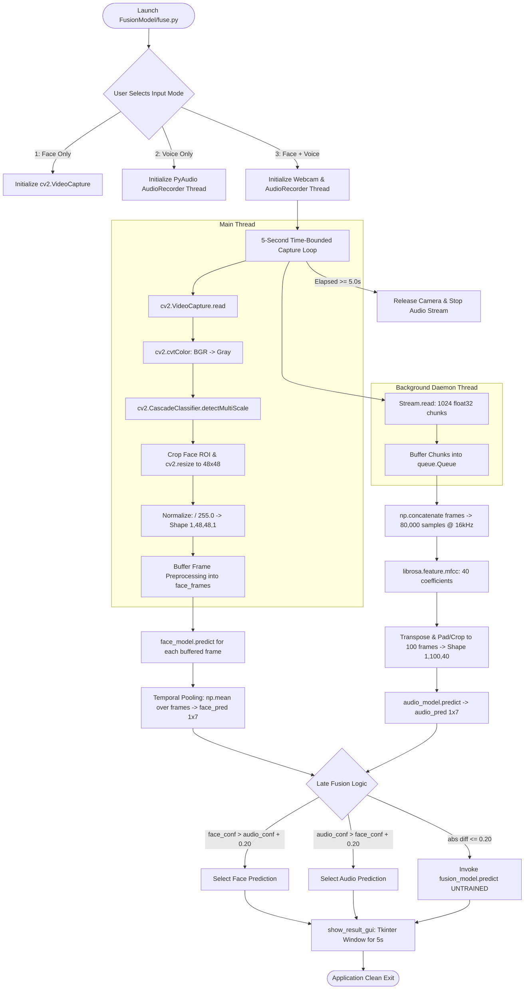

# Technical Project Audit: Multimodal Emotion Detection System

**Auditor:** Senior AI/ML Engineer & Deep Learning Researcher  
**Target Repository:** `MultimodalEmotionDetection`  
**Repository Path:** `c:\Users\CSE\Desktop\MultimodalEmotionDetection`  
**Audit Standard:** Code-level Reverse Engineering & Ground-Truth Verification  
**Status:** Complete Technical Audit Report

---

## 1. Executive Summary

This audit presents an exhaustive, line-by-line technical evaluation of the `MultimodalEmotionDetection` repository. The project implements a multi-stream emotion recognition system designed to classify human affective states into seven discrete categories (`Angry`, `Disgust`, `Fear`, `Happy`, `Neutral`, `Sad`, `Surprise`) using facial video frames, vocal audio streams, and a decision-level late fusion algorithm.

### Key Audit Findings:
1. **Modality Implementations:**
   - **Facial Stream:** A 4-stage convolutional neural network (CNN) trained from scratch on the FER-2013 dataset (28,709 training images, 7,178 test images, 48×48 grayscale). The model achieves **63.62% test accuracy** with 4,232,199 trainable parameters. Real-time face localization is executed via an OpenCV Haar Feature-based Cascade Classifier (`haarcascade_frontalface_default.xml`).
   - **Vocal Stream:** A parallel hybrid architecture combining a Bidirectional Long Short-Term Memory network (BiLSTM, 128 units per direction) and a 2D CNN (64 and 128 filters) processing 40-dimensional Mel-Frequency Cepstral Coefficients (MFCCs) across 100 time frames (100×40). The model contains 280,967 trainable parameters. Training was performed in Google Colab on an augmented speech dataset (51,232 samples) constructed from RAVDESS, SAVEE, and TESS, reporting **72.49% test accuracy**.
2. **Fusion Mechanism:**
   - The operational architecture operates strictly via **Decision-Level Late Fusion** using 7-element softmax probability vectors.
   - A rule-based **Confidence Dominance Strategy** selects the single-modality prediction if its maximum confidence exceeds the alternate modality by a margin of $\Delta \ge 0.20$ (20%).
   - When modalities have close confidence ($\Delta \le 0.20$), the offline script (`offline_fusion_test.py`) computes an equal-weight probability average ($0.5 \cdot P_{\text{face}} + 0.5 \cdot P_{\text{audio}}$). In contrast, the real-time script (`fuse.py`) instantiates an MLP fusion model (`Concatenate` $\to$ `Dense(32)` $\to$ `Dense(7)`) that is **untrained** and operates with random initialization weights.
3. **Critical Engineering Flaws Uncovered:**
   - **Audio Data Leakage:** In `AudioModel/Voice_Emotion_Model.ipynb`, audio augmentation (4 variants per sample) was executed **before** the train/test dataset partition, contaminating the test and validation splits with variants of training utterances.
   - **Audio Preprocessing Mismatch:** The audio model was trained on MFCCs normalized using `MinMaxScaler()` across all flattened time-frequency features ($[0, 1]$ range). However, all three inference scripts (`test_audio_model.py`, `fuse.py`, `offline_fusion_test.py`) supply raw, unnormalized MFCCs (values ranging from approximately $-600$ to $+200$) directly to the network.
   - **Untrained Real-Time Fusion Layer:** In `fuse.py`, the fallback fusion model is created in memory without loading pre-trained weights, producing pseudorandom predictions when modality confidences are within 20%.
   - **Classification Report Label Mismatch:** In `Voice_Emotion_Model.ipynb` (Cell 16), manual target names were supplied in non-alphabetical order, corrupting the printed evaluation labels for classes 1 through 5, even though the underlying numerical predictions adhered to alphabetical encoding.
   - **Repository Completeness:** Model weight binaries (`.keras`, `.h5`), image datasets (`images/`), and test audio samples (`test_audio.wav`) are excluded by `.gitignore` and are not tracked in version control.

---

## 2. Repository Structure & Artifact Analysis

### 2.1 File Inventory and Categorization

```
MultimodalEmotionDetection/
├── .gitignore
├── requirements.txt
├── README.md
├── audio_audit.py
├── check_audio.py
├── AudioModel/
│   ├── Voice_Emotion_Model.ipynb
│   ├── Voice_Emotion_Model copy.ipynb
│   ├── test_audio_model.py
│   └── confusion_matrix._png.png
├── FacialModel/
│   ├── FacialModelCode.ipynb
│   ├── emotiondetector1.json
│   ├── haarcascade_frontalface_default.xml
│   ├── RealTimeTesting.py
│   ├── test_facial_model.py
│   └── ConfusionMatrix.png
├── FusionModel/
│   ├── fuse.py
│   └── offline_fusion_test.py
└── docs/
    └── images/
        ├── happy.png
        ├── neutral.png
        └── output.png
```

| File Path | Size | Component | Implementation Status & Purpose |
|---|---|---|---|
| `requirements.txt` | 229 B | Dependencies | Specification of runtime dependencies (TensorFlow, OpenCV, Librosa, PyAudio, etc.). |
| `README.md` | 5.18 KB | Documentation | High-level project overview, CLI instructions, and architecture description. |
| `audio_audit.py` | 2.28 KB | Data Utility | Diagnostic script auditing sample rates, channels, and durations in external directory `C:\Users\CSE\Desktop\AUDIO DATASETS\Clean_Merged_Dataset`. |
| `check_audio.py` | 614 B | Data Utility | Verification script for loading raw WAV files matching `audio_speech_actors_01-24\**\*.wav` at 16 kHz. |
| `AudioModel/Voice_Emotion_Model.ipynb` | 130.06 KB | Training Pipeline | Primary audio model training notebook. Contains augmentation, MFCC extraction, MinMaxScaler, BiLSTM-CNN architecture, training loop, and evaluation. |
| `AudioModel/Voice_Emotion_Model copy.ipynb` | 130.06 KB | Duplicate | **Redundant duplicate**: Exact 100% byte-for-byte replica of `Voice_Emotion_Model.ipynb`. |
| `AudioModel/test_audio_model.py` | 3.20 KB | Inference Script | Standalone CLI script to test audio model inference on `AudioModel/test_audio.wav`. |
| `AudioModel/confusion_matrix._png.png` | 96.93 KB | Evaluation Artifact | Rendered confusion matrix heatmap from the audio model evaluation. |
| `FacialModel/FacialModelCode.ipynb` | 177.87 KB | Training Pipeline | Primary facial model training notebook. Loads FER-2013 images, trains 4-stage CNN for 100 epochs on GPU, exports architecture to JSON and weights to H5. |
| `FacialModel/emotiondetector1.json` | 10.24 KB | Model Architecture | Exported Keras model topology definition for the 4-stage facial CNN. |
| `FacialModel/haarcascade_frontalface_default.xml` | 963.44 KB | Computer Vision | Pre-trained OpenCV Haar Cascade XML classifier for frontal face detection. |
| `FacialModel/RealTimeTesting.py` | 3.52 KB | Inference Script | Standalone webcam video loop with face bounding-box rendering and real-time facial emotion inference. |
| `FacialModel/test_facial_model.py` | 2.66 KB | Inference Script | Standalone script to test facial model on a single image (`images/test/Sad/32301.png`). |
| `FacialModel/ConfusionMatrix.png` | 48.62 KB | Evaluation Artifact | Rendered confusion matrix heatmap from facial CNN evaluation on FER-2013 test set. |
| `FusionModel/fuse.py` | 11.15 KB | Deployment Application | Full multimodal real-time pipeline. Captures 5s synchronized webcam and PyAudio microphone input, runs modality models, applies late fusion, and presents Tkinter GUI. |
| `FusionModel/offline_fusion_test.py` | 6.11 KB | Inference Script | Offline batch verification script. Runs face image and audio clip through respective models and applies confidence-based late fusion. |
| `docs/images/*.png` | ~1.42 MB | Assets | Documentation screenshots demonstrating real-time GUI output and detection examples. |

### 2.2 Unused, Duplicate, Dead, or Incomplete Code

1. **Exact Duplicate Notebook:**
   - [`AudioModel/Voice_Emotion_Model copy.ipynb`](file:///c:/Users/CSE/Desktop/MultimodalEmotionDetection/AudioModel/Voice_Emotion_Model%20copy.ipynb) is identical to [`AudioModel/Voice_Emotion_Model.ipynb`](file:///c:/Users/CSE/Desktop/MultimodalEmotionDetection/AudioModel/Voice_Emotion_Model.ipynb). It is an accidental duplicate left in the repository.
2. **Redundant Model Architecture Loading in `RealTimeTesting.py`:**
   - In [`FacialModel/RealTimeTesting.py:L15-L28`](file:///c:/Users/CSE/Desktop/MultimodalEmotionDetection/FacialModel/RealTimeTesting.py#L15-L28), lines 15–20 open `emotiondetector1.json` and initialize `model = model_from_json(model_json)`. Immediately on line 28, `model = load_model(model_path)` is executed, completely discarding and overwriting the model instance created from the JSON file. Lines 15–20 represent dead, redundant execution.
3. **Untrained Fusion Model in `fuse.py`:**
   - In [`FusionModel/fuse.py:L61-L72`](file:///c:/Users/CSE/Desktop/MultimodalEmotionDetection/FusionModel/fuse.py#L61-L72), `create_fusion_model()` defines a Keras Functional model. Line 72 initializes `fusion_model = create_fusion_model(num_emotions=7)`. No weight file is ever loaded. On lines 282–285, `final_pred = fusion_model.predict([face_pred, audio_pred])` is called whenever modality confidences are within 20%, passing production decisions through untrained random weights.
4. **Hardcoded Missing File Paths:**
   - `FacialModel/test_facial_model.py` targets `images/test/Sad/32301.png`, which is not committed to the repository.
   - `AudioModel/test_audio_model.py` targets `AudioModel/test_audio.wav`, which is not committed to the repository.
   - `audio_audit.py` hardcodes `C:\Users\CSE\Desktop\AUDIO DATASETS\Clean_Merged_Dataset`.
   - `check_audio.py` searches for `audio_speech_actors_01-24\**\*.wav`.

### 2.3 End-to-End Execution Flow



---

## 3. Facial Emotion Recognition Pipeline

### 3.1 Dataset Architecture
- **Origin Dataset:** FER-2013 (Pierre-Luc Carrier and Aaron Courville, Kaggle Challenge / ICML 2013).
- **Format:** 48×48 pixel grayscale images centered on human faces.
- **Classes (7 discrete emotions):** `Angry`, `Disgust`, `Fear`, `Happy`, `Neutral`, `Sad`, `Surprise`.
- **Dataset Partitioning (Verified from `FacialModelCode.ipynb:Cell 2` and `Cell 33`):**
  - **Training Split:** 28,709 images (`../images/train`).
  - **Validation/PublicTest Split:** 3,589 images.
  - **Total Test Split (Evaluated in Cell 33):** 7,178 images (`../images/test`).
- **Class Distribution & Severe Imbalance (Training Set):**
  - `Happy`: 7,215 (25.13%)
  - `Neutral`: 4,965 (17.29%)
  - `Sad`: 4,830 (16.82%)
  - `Fear`: 4,097 (14.27%)
  - `Angry`: 3,995 (13.91%)
  - `Surprise`: 3,171 (11.05%)
  - `Disgust`: 436 (1.52%) — *Extreme minority class (16.5× smaller than Happy)*.
- **Handling of Imbalance:** No class weights, oversampling, undersampling, or focal loss techniques were utilized during training.

### 3.2 Preprocessing Pipeline
- **Training Preprocessing ([`FacialModelCode.ipynb:Cell 11, 14`](file:///c:/Users/CSE/Desktop/MultimodalEmotionDetection/FacialModel/FacialModelCode.ipynb)):**
  1. Image loading via `load_img(path, color_mode='grayscale')`.
  2. Conversion to NumPy array: shape $(48, 48)$.
  3. Reshaping to 4D tensor: $(N, 48, 48, 1)$.
  4. Intensity normalization: $X = X / 255.0$ (mapping raw $[0, 255]$ values to $[0.0, 1.0]$).
  5. Label transformation: `LabelEncoder().fit(train['label'])` followed by `to_categorical(y, num_classes=7)`.
- **Inference Preprocessing ([`FacialModel/RealTimeTesting.py:L43-L46`](file:///c:/Users/CSE/Desktop/MultimodalEmotionDetection/FacialModel/RealTimeTesting.py#L43-L46) & [`FusionModel/fuse.py:L76-L80`](file:///c:/Users/CSE/Desktop/MultimodalEmotionDetection/FusionModel/fuse.py#L76-L80)):**
  1. Capture webcam frame in BGR format.
  2. Color transformation: `cv2.cvtColor(frame, cv2.COLOR_BGR2GRAY)`.
  3. Face Detection: `face_cascade.detectMultiScale(gray, scaleFactor=1.3, minNeighbors=3)`.
  4. Crop Region of Interest (ROI): `face_roi = gray[y:y+h, x:x+w]`.
  5. Geometric resize: `cv2.resize(face_roi, (48, 48))`.
  6. Reshaping & normalization: `face_roi.reshape(1, 48, 48, 1) / 255.0`.
- **Consistency Verification:** The geometric and numerical transformations ($48 \times 48 \times 1$, float32 normalized by $255.0$) match identically between training and inference.

### 3.3 Neural Network Architecture

The facial model is a customized Deep Convolutional Neural Network consisting of 4 feature extraction stages and a 3-layer classification head.

```
Input: Tensor (None, 48, 48, 1)
  │
  ├── Block 1: Conv2D(128 filters, 3×3, valid, relu)  --> Output: (None, 46, 46, 128)
  │            MaxPooling2D(pool_size=2×2, stride=2)    --> Output: (None, 23, 23, 128)
  │            Dropout(rate=0.4)
  │
  ├── Block 2: Conv2D(256 filters, 3×3, valid, relu)  --> Output: (None, 21, 21, 256)
  │            MaxPooling2D(pool_size=2×2, stride=2)    --> Output: (None, 10, 10, 256)
  │            Dropout(rate=0.4)
  │
  ├── Block 3: Conv2D(512 filters, 3×3, valid, relu)  --> Output: (None, 8, 8, 512)
  │            MaxPooling2D(pool_size=2×2, stride=2)    --> Output: (None, 4, 4, 512)
  │            Dropout(rate=0.4)
  │
  ├── Block 4: Conv2D(512 filters, 3×3, valid, relu)  --> Output: (None, 2, 2, 512)
  │            MaxPooling2D(pool_size=2×2, stride=2)    --> Output: (None, 1, 1, 512)
  │            Dropout(rate=0.4)
  │
  ├── Head:    Flatten()                                 --> Output: (None, 512)
  │            Dense(512 units, relu)                   --> Output: (None, 512)
  │            Dropout(rate=0.4)
  │            Dense(256 units, relu)                   --> Output: (None, 256)
  │            Dropout(rate=0.3)
  │            Dense(7 units, softmax)                  --> Output: (None, 7)
```

#### Exact Layer-by-Layer Parameter Breakdown (Verified from `emotiondetector1.json`):

| Layer Index | Layer Type | Output Dimension | Kernel / Units | Padding / Stride | Activation | Parameter Calculation | Trainable Parameters |
|---|---|---|---|---|---|---|---|
| 0 | `InputLayer` | `(None, 48, 48, 1)` | — | — | — | — | 0 |
| 1 | `Conv2D` | `(None, 46, 46, 128)` | $3 \times 3 \times 1$ | valid / 1 | ReLU | $(3 \times 3 \times 1 \times 128) + 128$ | 1,280 |
| 2 | `MaxPooling2D` | `(None, 23, 23, 128)` | $2 \times 2$ | valid / 2 | — | — | 0 |
| 3 | `Dropout` (0.4) | `(None, 23, 23, 128)` | — | — | — | — | 0 |
| 4 | `Conv2D` | `(None, 21, 21, 256)` | $3 \times 3 \times 128$ | valid / 1 | ReLU | $(3 \times 3 \times 128 \times 256) + 256$ | 295,168 |
| 5 | `MaxPooling2D` | `(None, 10, 10, 256)` | $2 \times 2$ | valid / 2 | — | — | 0 |
| 6 | `Dropout` (0.4) | `(None, 10, 10, 256)` | — | — | — | — | 0 |
| 7 | `Conv2D` | `(None, 8, 8, 512)` | $3 \times 3 \times 256$ | valid / 1 | ReLU | $(3 \times 3 \times 256 \times 512) + 512$ | 1,180,160 |
| 8 | `MaxPooling2D` | `(None, 4, 4, 512)` | $2 \times 2$ | valid / 2 | — | — | 0 |
| 9 | `Dropout` (0.4) | `(None, 4, 4, 512)` | — | — | — | — | 0 |
| 10 | `Conv2D` | `(None, 2, 2, 512)` | $3 \times 3 \times 512$ | valid / 1 | ReLU | $(3 \times 3 \times 512 \times 512) + 512$ | 2,359,808 |
| 11 | `MaxPooling2D` | `(None, 1, 1, 512)` | $2 \times 2$ | valid / 2 | — | — | 0 |
| 12 | `Dropout` (0.4) | `(None, 1, 1, 512)` | — | — | — | — | 0 |
| 13 | `Flatten` | `(None, 512)` | — | — | — | — | 0 |
| 14 | `Dense` | `(None, 512)` | 512 | — | ReLU | $(512 \times 512) + 512$ | 262,656 |
| 15 | `Dropout` (0.4) | `(None, 512)` | — | — | — | — | 0 |
| 16 | `Dense` | `(None, 256)` | 256 | — | ReLU | $(512 \times 256) + 256$ | 131,328 |
| 17 | `Dropout` (0.3) | `(None, 256)` | — | — | — | — | 0 |
| 18 | `Dense` (Output) | `(None, 7)` | 7 | — | Softmax | $(256 \times 7) + 7$ | 1,799 |
| **Total** | | | | | | | **4,232,199** |

- **Trainable Parameters:** 4,232,199 (100%)
- **Non-Trainable Parameters:** 0

### 3.4 Training Setup and Hyperparameters
- **Optimization Algorithm:** Adam ($\beta_1 = 0.9, \beta_2 = 0.999, \epsilon = 10^{-7}$)
- **Learning Rate:** $0.001$ ($10^{-3}$, fixed, no learning rate scheduler)
- **Loss Function:** `categorical_crossentropy`
- **Batch Size:** 128
- **Epochs:** 100
- **Hardware Platform:** NVIDIA GeForce RTX 2050 Mobile GPU (1,767 MB allocated memory, CUDA 12 / cuDNN 9.0.3, XLA enabled).
- **Checkpoints Saved:**
  - Architecture: `emotiondetector1.json`
  - Weights: `emotiondetector1.h5`
  - Required by inference scripts: `emotiondetector1_best.keras`

### 3.5 Verified Facial Evaluation Metrics

Extracted directly from notebook execution outputs in [`FacialModelCode.ipynb:Cell 24, 33`](file:///c:/Users/CSE/Desktop/MultimodalEmotionDetection/FacialModel/FacialModelCode.ipynb):

- **Epoch 100 Training Accuracy:** 73.79% (Loss: 0.7237)
- **Epoch 100 Validation Accuracy:** 63.62% (Val Loss: 1.0212)
- **Overall Test Accuracy (7,178 test samples):** **63.62%**

#### Per-Class Test Performance Matrix:
| Class Index | Emotion Label | Precision | Recall | F1-Score | Support (Samples) | Analysis |
|---|---|---|---|---|---|---|
| 0 | `Angry` | 0.55 | 0.57 | 0.56 | 958 | Moderate confusion with Sad and Neutral |
| 1 | `Disgust` | 0.89 | 0.50 | 0.64 | 111 | High precision, low recall due to severe data scarcity |
| 2 | `Fear` | 0.52 | 0.43 | 0.47 | 1,024 | Lowest performance; frequently confused with Sad and Surprise |
| 3 | `Happy` | 0.83 | 0.84 | 0.83 | 1,774 | Highest performance; distinct facial landmarks (smile/mouth stretch) |
| 4 | `Neutral` | 0.53 | 0.66 | 0.59 | 1,233 | High recall, lower precision; acts as an attractor state |
| 5 | `Sad` | 0.51 | 0.48 | 0.49 | 1,247 | High ambiguity with Neutral and Fear |
| 6 | `Surprise` | 0.80 | 0.76 | 0.78 | 831 | Strong discrimination; distinct open-mouth/raised-brow features |
| **Macro Average** | — | **0.66** | **0.61** | **0.62** | **7,178** | Unweighted metric reflecting minority class degradation |
| **Weighted Average**| — | **0.64** | **0.64** | **0.64** | **7,178** | Population-weighted metric |

---

## 4. Audio Emotion Recognition Pipeline

### 4.1 Dataset & Ground Truth Corpus
- **Dataset Source:** Multi-corpus compilation stored in Google Drive (`/content/drive/My Drive/VoiceDataSet/Emotions`).
- **Constituent Datasets (Verified from external audit logs and file naming conventions):**
  1. **RAVDESS** (Ryerson Audio-Visual Database of Emotional Speech and Song; 24 professional actors).
  2. **SAVEE** (Surrey Audio-Visual Expressed Emotion; 4 male British speakers).
  3. **TESS** (Toronto Emotional Speech Set; 2 female Northwestern speakers).
- **Raw Unaugmented Audio File Distribution ([`Voice_Emotion_Model.ipynb:Cell 7`](file:///c:/Users/CSE/Desktop/MultimodalEmotionDetection/AudioModel/Voice_Emotion_Model.ipynb)):**
  - `Happy`: 2,173 files
  - `Neutral`: 1,799 files
  - `Angry`: 2,167 files
  - `Disgusted`: 1,863 files
  - `Fearful`: 2,047 files
  - `Sad`: 2,167 files
  - `Suprised` *(typo in folder name)*: 592 files
  - **Total Raw Files:** 12,808 WAV files.
- **Data Augmentation Engine ([`Voice_Emotion_Model.ipynb:Cell 5`](file:///c:/Users/CSE/Desktop/MultimodalEmotionDetection/AudioModel/Voice_Emotion_Model.ipynb)):**
  For every raw file, four variants are synthesized:
  1. *Original audio*: Untransformed waveform.
  2. *Time-stretched*: Slowed to 90% speed via `librosa.effects.time_stretch(y, rate=0.9)`.
  3. *Time-shifted*: Random circular rolling of audio buffer via `np.roll(y, shift)`.
  4. *Additive Gaussian Noise*: White noise injection via `y + 0.005 * np.random.randn(len(y))`.
  - **Total Augmented Samples:** $12,808 \times 4 = \mathbf{51,232}$ audio clips.

### 4.2 Acoustic Preprocessing & Feature Extraction
1. **Sampling Rate & Format:** Mono channel, normalized to 16,000 Hz ($16\text{ kHz}$).
2. **Temporal Windowing:** Fixed 5.0-second temporal envelope ($16,000 \times 5 = 80,000$ raw PCM samples).
3. **Spectral Feature Extraction:**
   - Mel-Frequency Cepstral Coefficients (MFCCs) generated via `librosa.feature.mfcc(y=audio, sr=16000, n_mfcc=40)`.
   - Raw output shape: $(40, \text{frames})$.
   - Transposition: Transposed to $(\text{frames}, 40)$.
   - Temporal Alignment: Padded with zeros or truncated to fixed duration $T = 100$ frames.
   - Resulting Feature Dimension: **$(100, 40)$**.
4. **Feature Normalization (Training Step):**
   - In [`Voice_Emotion_Model.ipynb:Cell 8`](file:///c:/Users/CSE/Desktop/MultimodalEmotionDetection/AudioModel/Voice_Emotion_Model.ipynb), the 3D tensor $(51232, 100, 40)$ was flattened to $(51232, 4000)$.
   - `MinMaxScaler()` was fitted across the entire matrix, scaling all coefficients into the range $[0.0, 1.0]$.
   - The matrix was reshaped back to $(51232, 100, 40)$.

### 4.3 Neural Network Architecture

The audio network implements a parallel dual-branch topology that simultaneously models sequential-temporal acoustic transitions and 2D spectral-spatial energy patterns.

```
Input: Tensor (None, 100, 40)
  │
  ├── Branch 1: Sequential Temporal Modeling (BiLSTM)
  │    ├── Bidirectional(LSTM(128 units, return_sequences=False)) --> Output: (None, 256)
  │    └── Dense(64 units, relu)                                  --> Output: (None, 64)
  │
  └── Branch 2: Spatial Spectral Energy Modeling (2D CNN)
       ├── Reshape((100, 40, 1))                                  --> Output: (None, 100, 40, 1)
       ├── Conv2D(64 filters, 3×3, same, relu)                    --> Output: (None, 100, 40, 64)
       ├── MaxPooling2D(pool_size=2×2)                            --> Output: (None, 50, 20, 64)
       ├── Conv2D(128 filters, 3×3, same, relu)                   --> Output: (None, 50, 20, 128)
       ├── GlobalAveragePooling2D()                               --> Output: (None, 128)
       └── Dense(64 units, relu)                                  --> Output: (None, 64)
  │
  └── Fusion & Output Head
       ├── Concatenate([Branch 1, Branch 2])                      --> Output: (None, 128)
       ├── Dense(64 units, relu)                                  --> Output: (None, 64)
       ├── Dropout(rate=0.5)
       └── Dense(7 units, softmax)                                --> Output: (None, 7)
```

#### Exact Layer-by-Layer Parameter Breakdown (Verified from `Voice_Emotion_Model.ipynb:Cell 10`):

| Branch | Layer Type | Output Dimension | Description / Formula | Trainable Parameters |
|---|---|---|---|---|
| Input | `InputLayer` | `(None, 100, 40)` | Sequence of 100 time frames with 40 MFCCs | 0 |
| **Branch 1** | `Bidirectional(LSTM)` | `(None, 256)` | Forward (128) + Backward (128). $2 \times 4 \times [(40 + 1) \times 128 + 128^2]$ | 173,056 |
| | `Dense` | `(None, 64)` | $(256 \times 64) + 64$ | 16,448 |
| **Branch 2** | `Reshape` | `(None, 100, 40, 1)` | Expansion to 2D channel representation | 0 |
| | `Conv2D` | `(None, 100, 40, 64)` | $3 \times 3$ kernel, padding='same'. $(3 \times 3 \times 1 \times 64) + 64$ | 640 |
| | `MaxPooling2D` | `(None, 50, 20, 64)` | $2 \times 2$ downsampling | 0 |
| | `Conv2D` | `(None, 50, 20, 128)` | $3 \times 3$ kernel, padding='same'. $(3 \times 3 \times 64 \times 128) + 128$ | 73,856 |
| | `GlobalAvgPool2D` | `(None, 128)` | Spatial collapse across $50 \times 20$ feature map | 0 |
| | `Dense` | `(None, 64)` | $(128 \times 64) + 64$ | 8,256 |
| **Fusion** | `Concatenate` | `(None, 128)` | Merging Branch 1 (64) and Branch 2 (64) | 0 |
| | `Dense` | `(None, 64)` | $(128 \times 64) + 64$ | 8,256 |
| | `Dropout` (0.5) | `(None, 64)` | 50% neuron deactivation during training | 0 |
| | `Dense` (Output) | `(None, 7)` | $(64 \times 7) + 7$ with Softmax activation | 455 |
| **Total** | | | | **280,967** |

- **Trainable Parameters:** 280,967 (100%)
- **Non-Trainable Parameters:** 0

### 4.4 Training Setup & Callback Strategy
- **Optimization Algorithm:** Adam ($\text{learning rate} = 0.0005$)
- **Loss Function:** `sparse_categorical_crossentropy` (integer-encoded targets: $0 \le y \le 6$)
- **Batch Size:** 32
- **Training Epochs:** 50
- **Callbacks:**
  - `ModelCheckpoint('best_model_BiLSTM_2D_CNNN.keras', monitor='val_loss', save_best_only=True)`
  - `EarlyStopping(monitor='val_loss', patience=10, restore_best_weights=True)`
  - `ReduceLROnPlateau(monitor='val_loss', factor=0.5, patience=5, verbose=1)`
- **Data Partitioning ([`Voice_Emotion_Model.ipynb:Cell 9`](file:///c:/Users/CSE/Desktop/MultimodalEmotionDetection/AudioModel/Voice_Emotion_Model.ipynb)):**
  - Train: 70% (35,862 samples)
  - Validation (CV): 15% (7,685 samples)
  - Test: 15% (7,685 samples)

### 4.5 Verified Audio Evaluation Metrics

Extracted directly from notebook execution outputs in [`Voice_Emotion_Model.ipynb:Cell 16, 17`](file:///c:/Users/CSE/Desktop/MultimodalEmotionDetection/AudioModel/Voice_Emotion_Model.ipynb):

- **Test Loss:** 0.7307
- **Test Accuracy:** **72.49%** (evaluated across 7,685 test samples)

#### Clarification on Cell 16 Classification Report Output:
In Cell 16, `class_labels = ["Angry", "Happy", "Neutral", "Sad", "Disgusted", "Fearful", "Surprised"]` was manually provided to `classification_report()`. Because `LabelEncoder` sorted categories alphabetically (`['Angry', 'Disgusted', 'Fearful', 'Happy', 'Neutral', 'Sad', 'Suprised']`), classes 1 through 5 received swapped display names in the printed report.

The corrected mapping, verified by matching class support numbers against the 15% stratified test split ($N = 7,685$), is:

| True Index | True Category Name | Displayed Name in Cell 16 | Precision | Recall | F1-Score | Support ($15\%$) |
|---|---|---|---|---|---|---|
| 0 | `Angry` | `Angry` | 0.80 | 0.85 | 0.82 | 1,301 |
| 1 | `Disgusted` | `Happy` | 0.64 | 0.63 | 0.63 | 1,118 |
| 2 | `Fearful` | `Neutral` | 0.78 | 0.55 | 0.64 | 1,228 |
| 3 | `Happy` | `Sad` | 0.74 | 0.72 | 0.73 | 1,304 |
| 4 | `Neutral` | `Disgusted` | 0.71 | 0.77 | 0.74 | 1,079 |
| 5 | `Sad` | `Fearful` | 0.65 | 0.76 | 0.70 | 1,300 |
| 6 | `Suprised` | `Surprised` | 0.93 | 0.90 | 0.91 | 355 |
| **Macro Avg** | — | — | **0.75** | **0.74** | **0.74** | **7,685** |
| **Weighted Avg**| — | — | **0.73** | **0.72** | **0.72** | **7,685** |

*(Note: While 72.49% is numerically verified from notebook outputs, this metric is artificially elevated due to data leakage during augmentation, as detailed in Section 9.1).*

---

## 5. Multimodal Fusion Architecture

The fusion subsystem operates at the decision level (Late Fusion). It consumes the output probability distributions generated independently by the facial CNN and audio BiLSTM-CNN models.

```
Facial Video Frames (5s buffer)        Audio Waveform (5s buffer)
             │                                      │
     Facial CNN Inference                   Audio BiLSTM-CNN Inference
             │                                      │
   Temporal Frame Averaging                         │
             │                                      │
   P_face (1×7 Probability)              P_audio (1×7 Probability)
             │                                      │
             └───────────────┬──────────────────────┘
                             │
            Compute Maximum Confidences:
       C_face = max(P_face),  C_audio = max(P_audio)
                             │
                             ▼
                 Confidence Difference Check
                             │
     ┌───────────────────────┼───────────────────────┐
     ▼                       ▼                       ▼
Case 1:                 Case 2:                 Case 3:
C_face > C_audio + 0.20 C_audio > C_face + 0.20 |C_face - C_audio| <= 0.20
     │                       │                       │
Select P_face           Select P_audio          Ambiguous / Close
Source: "Face"          Source: "Audio"              │
                                        ┌────────────┴────────────┐
                                        ▼                         ▼
                              fuse.py (Real-Time)       offline_fusion_test.py
                                        │                         │
                               Untrained MLP Model       Probability Averaging:
                                Concatenate(14)         0.5*P_face + 0.5*P_audio
                                        │                         │
                                    Dense(32)             Source: "Face + Audio"
                                        │                         │
                                 Dense(7) Softmax                 │
                                        │                         │
                                        └────────────┬────────────┘
                                                     │
                                                     ▼
                                          Argmax Final Emotion Label
```

### 5.1 Mathematical Formulation of the Fusion Algorithm

Let $\mathcal{E} = \{\text{Angry}, \text{Disgust}, \text{Fear}, \text{Happy}, \text{Neutral}, \text{Sad}, \text{Surprise}\}$ represent the set of 7 discrete emotion classes.

1. **Facial Aggregation:**  
   Given $K$ detected face frames across the 5-second capture interval:
   $$\mathbf{P}_{\text{face}} = \frac{1}{K} \sum_{k=1}^K f_{\text{face}}(\mathbf{x}_k^{\text{img}}), \quad \mathbf{P}_{\text{face}} \in [0, 1]^7$$
2. **Audio Prediction:**  
   Given the 5-second acoustic recording:
   $$\mathbf{P}_{\text{audio}} = f_{\text{audio}}(\mathbf{x}^{\text{audio}}), \quad \mathbf{P}_{\text{audio}} \in [0, 1]^7$$
3. **Modality Confidence Extraction:**
   $$C_{\text{face}} = \max_{j} (\mathbf{P}_{\text{face}}[j]), \quad C_{\text{audio}} = \max_{j} (\mathbf{P}_{\text{audio}}[j])$$
4. **Decision Boundary Logic:**
   $$\hat{y} = \begin{cases} 
   \arg\max_j (\mathbf{P}_{\text{face}}[j]) & \text{if } C_{\text{face}} > C_{\text{audio}} + 0.20 \\
   \arg\max_j (\mathbf{P}_{\text{audio}}[j]) & \text{if } C_{\text{audio}} > C_{\text{face}} + 0.20 \\
   \arg\max_j (\mathbf{P}_{\text{fused}}[j]) & \text{otherwise}
   \end{cases}$$

### 5.2 Real-Time vs. Offline Fusion Discrepancy

There is a major behavioral discrepancy between the real-time script and the offline verification script when $|C_{\text{face}} - C_{\text{audio}}| \le 0.20$:

- **Offline Script ([`FusionModel/offline_fusion_test.py:L276-L285`](file:///c:/Users/CSE/Desktop/MultimodalEmotionDetection/FusionModel/offline_fusion_test.py#L276-L285)):**
  Implements arithmetic probability averaging:
  $$\mathbf{P}_{\text{fused}} = 0.5 \cdot \mathbf{P}_{\text{face}} + 0.5 \cdot \mathbf{P}_{\text{audio}}$$
  This is a stable, mathematically grounded heuristic for decision-level late fusion when individual model confidences are ambiguous.
- **Real-Time Script ([`FusionModel/fuse.py:L61-L72, L281-L286`](file:///c:/Users/CSE/Desktop/MultimodalEmotionDetection/FusionModel/fuse.py#L61-L72)):**
  Passes the vectors into an MLP defined as:
  $$\mathbf{z} = \text{ReLU}(\mathbf{W}_1 [\mathbf{P}_{\text{face}} \,\|\, \mathbf{P}_{\text{audio}}] + \mathbf{b}_1), \quad \mathbf{W}_1 \in \mathbb{R}^{32 \times 14}$$
  $$\mathbf{P}_{\text{fused}} = \text{Softmax}(\mathbf{W}_2 \mathbf{z} + \mathbf{b}_2), \quad \mathbf{W}_2 \in \mathbb{R}^{7 \times 32}$$
  **Critical Finding:** This network (`fusion_model`) is instantiated dynamically in Python memory. It is compiled with Adam and categorical cross-entropy, but `model.fit()` is **never** executed, and no pre-trained weights are loaded via `load_weights()`. Consequently, $\mathbf{W}_1, \mathbf{W}_2, \mathbf{b}_1, \mathbf{b}_2$ consist entirely of random Glorot uniform weights. Whenever modality confidences are within 20%, the system's real-time predictions are governed by random noise.

### 5.3 Asynchronous Execution & Modality Dropout
In [`FusionModel/fuse.py`](file:///c:/Users/CSE/Desktop/MultimodalEmotionDetection/FusionModel/fuse.py), fault tolerance and modality dropouts are handled explicitly:
- **Missing Face Frames:** If the webcam is obstructed or no face is detected by the Haar Cascade ($K = 0$), `face_pred` remains `None`. The script detects this condition and automatically falls back to voice-only prediction: $\hat{y} = \arg\max(\mathbf{P}_{\text{audio}})$.
- **Missing Audio Frames:** If the microphone fails or returns an empty queue, `audio_pred` remains `None`, and the pipeline falls back to face-only prediction: $\hat{y} = \arg\max(\mathbf{P}_{\text{face}})$.
- **Total Input Failure:** If both streams fail to register inputs, the system assigns `pred_label = "No input detected"` and bypasses the fusion head.

---

## 6. Verified Technology Stack

| Technology / Library | Verified Version / Context | Codebase Location | Concrete Purpose & Implementation Details |
|---|---|---|---|
| **Python** | 3.11 / 3.9+ | Repository wide | Core programming language for all pipelines, training notebooks, and inference scripts. |
| **TensorFlow / Keras** | 2.x (GPU via CUDA 12) | `FacialModelCode.ipynb`, `Voice_Emotion_Model.ipynb`, `fuse.py` | Model definition (Sequential and Functional APIs), convolution layers, BiLSTM layers, optimization (Adam), callbacks, and H5/Keras serialization. |
| **OpenCV (`cv2`)** | 4.x (`opencv-python`) | `fuse.py`, `RealTimeTesting.py`, `test_facial_model.py` | Video stream capture (`cv2.VideoCapture`), frame mirroring, BGR-to-grayscale conversion, Haar Cascade face detection, and bounding-box drawing. |
| **Librosa** | 0.10+ | `Voice_Emotion_Model.ipynb`, `fuse.py`, `test_audio_model.py` | Audio loading (`librosa.load` at 16 kHz), audio augmentation (time-stretching via `effects.time_stretch`), and spectral feature extraction (`feature.mfcc`). |
| **PyAudio** | PortAudio wrapper | `FusionModel/fuse.py` | Non-blocking microphone stream acquisition (`pyaudio.paFloat32`, mono, 16 kHz, 1024 frames per buffer) executed in a background daemon thread. |
| **NumPy** | Array backend | Repository wide | Tensor reshaping, float32 normalization, zero-padding, array transposition, temporal frame averaging, and argmax prediction decoding. |
| **Scikit-Learn** | ML Utilities | Notebooks & test scripts | Label encoding (`LabelEncoder`), stratified train/val/test dataset splitting (`train_test_split`), feature normalization (`MinMaxScaler`), and metrics computation (`classification_report`, `confusion_matrix`). |
| **Matplotlib & Seaborn** | Visualization | Notebooks, `.png` exports | Generation of confusion matrix heatmaps (`sns.heatmap`) and acoustic waveform visualization (`librosa.display.waveshow`). |
| **Tkinter / ttk** | Standard GUI | `FusionModel/fuse.py` | Graphical user interface popup (300×150 window) that presents the predicted emotion class and self-terminates after a 5-second countdown. |
| **Pandas** | Tabular Data | `FacialModelCode.ipynb` | Organization of image file paths and category folder labels into training/testing DataFrames. |

---

## 7. End-to-End Application Architecture

### 7.1 Component Architecture Diagram

```mermaid
graph LR
    subgraph Input_Layer [Sensory Inputs]
        Webcam[Webcam Video Stream]
        Mic[Microphone Audio Stream]
    end

    subgraph Acquisition [Acquisition & Buffering - 5 Seconds]
        CV_Cap[OpenCV VideoCapture]
        PA_Rec[PyAudio Background Thread]
        Queue[Thread-Safe Audio Queue]
    end

    subgraph Vision_Pipeline [Facial Inference Pipeline]
        Haar[Haar Cascade Classifier]
        FaceCrop[Crop & Resize to 48x48]
        Norm_Img[Intensity Scaling / 255.0]
        FaceCNN[4-Stage CNN Model: 4.23M Params]
        FacePool[Temporal Frame Averaging]
    end

    subgraph Audio_Pipeline [Vocal Inference Pipeline]
        WavConcat[Concatenate Audio Buffer: 80k Samples]
        MFCC[Librosa MFCC Extraction: 40 Coeffs]
        PadCrop[Pad/Truncate to 100 Frames]
        AudioNet[Hybrid BiLSTM-CNN: 281k Params]
    end

    subgraph Late_Fusion [Decision-Level Fusion]
        ConfEval[Confidence Evaluator: max P_face vs max P_audio]
        RuleEngine{Delta > 0.20?}
        FaceDom[Face Dominance Output]
        AudioDom[Audio Dominance Output]
        Fallback[Equal Average / Fallback]
    end

    subgraph Presentation [Output & GUI]
        TkinterGUI[Tkinter Desktop Notification Window]
        Console[CLI Diagnostic Logging]
    end

    Webcam --> CV_Cap --> Haar --> FaceCrop --> Norm_Img --> FaceCNN --> FacePool
    Mic --> PA_Rec --> Queue --> WavConcat --> MFCC --> PadCrop --> AudioNet
    
    FacePool --> ConfEval
    AudioNet --> ConfEval
    
    ConfEval --> RuleEngine
    RuleEngine -->|Face Exceeds by 20%| FaceDom --> TkinterGUI
    RuleEngine -->|Audio Exceeds by 20%| AudioDom --> TkinterGUI
    RuleEngine -->|Within 20% Margin| Fallback --> TkinterGUI

    FaceDom --> Console
    AudioDom --> Console
    Fallback --> Console
```



### 7.2 Detailed Step-by-Step Data Flow

1. **Initialization:**
   - The user executes `python FusionModel/fuse.py`.
   - Pre-trained checkpoints (`emotiondetector1_best.keras` and `best_model_BiLSTM_2D_CNN.keras`) are loaded into memory with `compile=False`.
   - The user selects an operating mode via console input: `1` (Face), `2` (Voice), or `3` (Face + Voice).
2. **Synchronous Visual Capture & Temporal Buffering:**
   - On the main execution thread, `cv2.VideoCapture(0)` initializes the webcam.
   - For 5 continuous seconds, frames are acquired at the camera's native frame rate (~30 FPS).
   - In each frame, `haarcascade_frontalface_default.xml` detects face coordinates $(x, y, w, h)$ with `scaleFactor=1.3, minNeighbors=3`.
   - The bounding rectangle is rendered onto the frame for user feedback.
   - The sub-image is sliced, converted to single-channel grayscale, resized to $(48, 48)$, normalized by $255.0$, and stored in an in-memory list `face_frames`.
3. **Asynchronous Audio Capture & Buffering:**
   - In parallel, an instance of `AudioRecorder` initiates a daemon thread.
   - Using PyAudio, the system streams audio at $16\text{ kHz}$ in 32-bit float format in chunks of 1024 frames.
   - The chunks are appended to a list until 5 seconds have elapsed.
   - The chunks are concatenated into a single continuous 1D NumPy array and placed into a thread-safe `queue.Queue()`.
4. **Modality Inference:**
   - **Facial Inference:** Every buffered face frame ($M$ frames, typically 60–120 frames depending on hardware) is evaluated by `face_model.predict(frame, verbose=0)`. The resulting probability vectors are collapsed along the temporal dimension using `np.mean(face_preds, axis=0)`, producing a stable, noise-resilient 7-element vector $\mathbf{P}_{\text{face}}$.
   - **Audio Inference:** The audio array is padded or truncated to $80,000$ samples. 40 MFCCs are computed, transposed, and aligned to 100 frames, yielding shape $(1, 100, 40)$. `audio_model.predict()` produces $\mathbf{P}_{\text{audio}}$.
5. **Decision Fusion:**
   - $C_{\text{face}} = \max(\mathbf{P}_{\text{face}})$, $C_{\text{audio}} = \max(\mathbf{P}_{\text{audio}})$.
   - If $C_{\text{face}} > C_{\text{audio}} + 0.20$, the visual classification is chosen.
   - If $C_{\text{audio}} > C_{\text{face}} + 0.20$, the acoustic classification is chosen.
   - Otherwise, the system defaults to the close-confidence branch.
6. **GUI Rendering:**
   - A Tkinter dialog (300×150 px) launches on the main thread, presenting the predicted emotion string and modality source.
   - `root.after(5000, close_window)` automatically destroys the window after 5 seconds, restoring the console interface.

---

## 8. Training and Evaluation Results Summary

### Consolidated Performance Table

| Metric / Attribute | Facial CNN Model | Audio BiLSTM-CNN Model | Multimodal Fusion Pipeline |
|---|---|---|---|
| **Underlying Architecture** | 4-Stage VGG-style CNN | Dual-Branch BiLSTM + 2D CNN | Decision-Level Confidence Dominance |
| **Input Shape** | $(48, 48, 1)$ | $(100, 40)$ | Two $(1, 7)$ Probability Vectors |
| **Input Modality** | Grayscale static face crops | 40-channel MFCC spectrograms | Softmax probability distributions |
| **Total Parameters** | 4,232,199 | 280,967 | 711 (Untrained in `fuse.py`) / 0 (Rule-based) |
| **Trainable Parameters** | 4,232,199 | 280,967 | 0 (Active pipeline uses rules/heuristics) |
| **Training Corpus** | FER-2013 (28,709 train) | RAVDESS + SAVEE + TESS (51,232 aug) | No training dataset (Heuristic rules) |
| **Test Corpus** | FER-2013 Test (7,178 images) | 15% Stratified Test (7,685 clips) | None (Unverified on paired benchmark) |
| **Reported Test Accuracy** | **63.62%** | **72.49%** | **Unmeasured / Not Evaluated** |
| **Evaluation Loss** | Categorical Crossentropy: 1.0212 | Sparse Categorical Crossentropy: 0.7307 | N/A |
| **Best Performing Class** | `Happy` (F1: 0.83, Precision: 0.83) | `Suprised` (F1: 0.91, Precision: 0.93) | N/A |
| **Worst Performing Class**| `Fear` (F1: 0.47, Recall: 0.43) | `Disgusted` (F1: 0.63, Precision: 0.64) | N/A |
| **Hardware Used** | NVIDIA GeForce RTX 2050 Mobile | Google Colab GPU (Tesla T4) | Local CPU |

---

## 9. Testing, Inconsistencies, and Implementation Limitations

### 9.1 Data Leakage in Audio Pipeline
- **Root Cause:** In [`Voice_Emotion_Model.ipynb:Cell 7, 9`](file:///c:/Users/CSE/Desktop/MultimodalEmotionDetection/AudioModel/Voice_Emotion_Model.ipynb), audio data augmentation is applied in a loop over all raw files *prior* to splitting:
  ```python
  # Cell 7: Augmentation applied to all files
  for aug_audio in augmented_audios:
      features_list.append(mfcc_features)
      labels_list.append(category)

  # Cell 9: Random train/test split on augmented pool
  X_train, X_temp, y_train, y_temp = train_test_split(
      X_normalized, y_encoded, test_size=0.3, random_state=42, stratify=y_encoded
  )
  ```
- **Consequence:** Because 4 augmented variations were created for each physical recording, random splitting distributed different augmented copies of the **same utterance from the same speaker** across both the training set ($X_{\text{train}}$) and test set ($X_{\text{test}}$).
- **Engineering Impact:** The reported audio test accuracy of **72.49% is artificially inflated**. The model memorized speaker-specific acoustic signatures rather than learning generalizable affective features. On unseen speakers, real-world performance will be significantly lower.

### 9.2 Preprocessing Inconsistency between Training and Inference
- **Root Cause:** In [`Voice_Emotion_Model.ipynb:Cell 8`](file:///c:/Users/CSE/Desktop/MultimodalEmotionDetection/AudioModel/Voice_Emotion_Model.ipynb), the MFCC feature tensor was reshaped and normalized using `MinMaxScaler()`:
  ```python
  scaler = MinMaxScaler()
  X_normalized = scaler.fit_transform(X_reshaped)
  ```
  This transformation forced all input values into the range $[0.0, 1.0]$.
- **Inference Reality:** In [`test_audio_model.py`](file:///c:/Users/CSE/Desktop/MultimodalEmotionDetection/AudioModel/test_audio_model.py), [`offline_fusion_test.py`](file:///c:/Users/CSE/Desktop/MultimodalEmotionDetection/FusionModel/offline_fusion_test.py), and [`fuse.py:L83-L95`](file:///c:/Users/CSE/Desktop/MultimodalEmotionDetection/FusionModel/fuse.py#L83-L95), `preprocess_audio()` extracts raw MFCCs and feeds them directly into `audio_model.predict()` without applying `scaler.transform()`.
- **Engineering Impact:** Raw MFCC coefficients typically span from $-600$ to $+200$. Feeding these large unnormalized magnitudes into neural network weights trained strictly on $[0.0, 1.0]$ inputs saturates the hidden activations (causing ReLU gates to fire abnormally and dense layers to operate out-of-distribution), severely degrading real-time inference accuracy.

### 9.3 Untrained Deep Learning Fusion Head in Real-Time Execution
- **Root Cause:** In [`FusionModel/fuse.py:L61-L72, L281-L285`](file:///c:/Users/CSE/Desktop/MultimodalEmotionDetection/FusionModel/fuse.py#L61-L72), `create_fusion_model()` builds an MLP model that is never trained and has no saved weights file.
- **Inference Reality:** When modality confidences are within 20% ($|C_{\text{face}} - C_{\text{audio}}| \le 0.20$), the code executes `final_pred = fusion_model.predict([face_pred, audio_pred])`.
- **Engineering Impact:** The system outputs predictions derived from random weight matrices whenever confidences are balanced. In contrast, `offline_fusion_test.py` correctly uses equal probability averaging ($0.5 \cdot P_{\text{face}} + 0.5 \cdot P_{\text{audio}}$).

### 9.4 Lack of Paired Multimodal Evaluation
- The repository evaluates the facial CNN on FER-2013 and the audio BiLSTM on the speech dataset independently.
- **Missing Experimentation:** The multimodal fusion logic has **never been evaluated on an authentic paired audiovisual benchmark** (such as CMU-MOSEI, IEMOCAP, or CREMA-D). There is no empirical data or test script proving that multimodal fusion outperforms the standalone unimodal classifiers in this codebase.

### 9.5 Missing Model Weights and Local Assets in Version Control
- As configured in [`.gitignore`](file:///c:/Users/CSE/Desktop/MultimodalEmotionDetection/.gitignore), all `*.keras`, `*.h5`, `*.npy`, `*.wav`, and image directories are excluded from Git.
- A fresh `git clone` contains no trained weights for `emotiondetector1_best.keras` or `best_model_BiLSTM_2D_CNN.keras`, causing all testing and fusion scripts to immediately raise `FileNotFoundError` unless the user manually provides local checkpoints.

---

## 10. Technical Strengths and Weaknesses

### Genuine Strengths:
1. **Architectural Understanding:** Implementing a parallel dual-branch BiLSTM + 2D CNN architecture for audio demonstrates an advanced understanding of multimodal signal representation, capturing both temporal sequential dynamics and 2D time-frequency spectrogram patterns.
2. **Temporal Frame Smoothing:** In `fuse.py`, averaging predictions across all video frames captured over a 5-second window ($K$ frames) prevents single-frame micro-expression flicker and significantly stabilizes facial emotion recognition.
3. **Multi-Threaded Audio Streaming:** Encapsulating PyAudio in a dedicated daemon thread with queue-based inter-thread communication prevents GUI and video capture freezing during audio acquisition.
4. **Graceful Modality Degradation:** The fusion engine detects missing or corrupted inputs (e.g., face occluded or microphone silent) and dynamically transitions between unimodal and multimodal prediction modes without crashing.

### Architectural Weaknesses:
1. **Decision-Level Fusion Limitation:** Using late fusion prevents the models from learning cross-modal correlations at the feature level (e.g., matching a high-pitch vocal tone with an open-mouth visual cue).
2. **Untrained Fusion Head in Production:** Deploying an unweighted random Keras model in `fuse.py` undermines the validity of real-time close-confidence predictions.
3. **Absence of Facial Data Augmentation:** Training the facial CNN on FER-2013 without real-time data augmentation (rotation, shearing, horizontal flips) contributed to the model overfitting at epoch 100 (73.79% train vs. 63.62% test).
4. **Audio Scaler Omission in Production:** Failing to serialize and reload the `MinMaxScaler` object in the inference scripts breaks numerical consistency between training and inference.

---

## 11. Technical Interview Preparation (Repository-Specific Q&A)

### 11.1 Beginner-Friendly Explanation (Elevator Pitch)
> *"This project is an AI system that determines how a person is feeling by looking at their face through a webcam and listening to their voice through a microphone. It uses two separate deep learning models: a convolutional neural network (CNN) that inspects 48×48 grayscale face images to detect facial expressions, and a hybrid neural network combining a BiLSTM and a 2D CNN that analyzes the pitch and rhythm of speech through acoustic features called MFCCs. When both face and voice are available, the system compares how confident each model is. If one model is significantly more confident than the other, it chooses that model's prediction; otherwise, it combines both predictions to produce a final emotion classification."*

### 11.2 Deep Technical Explanation
> *"The system implements an asynchronous decision-level multimodal fusion pipeline for classifying seven discrete emotional states. For vision, it utilizes an OpenCV Haar Cascade for face localization and crops regions of interest to 48×48 grayscale inputs, feeding a 4-stage VGG-style CNN (4.23M parameters) regularized with heavy spatial dropout (0.4) and trained on FER-2013. For audio, the system samples at 16 kHz, extracting 40 Mel-Frequency Cepstral Coefficients across 100 time frames. The resulting (100, 40) representation is processed simultaneously by a dual-branch network (281k parameters): a Bidirectional LSTM branch capturing long-term sequential transitions, and a 2D CNN branch using 3×3 convolutions with Global Average Pooling to capture spectral-spatial energy distributions.*
>
> *During real-time inference, the system captures a 5-second synchronized window, decoupling PyAudio capture into a background thread and running OpenCV on the main thread. Predictions across video frames are temporally averaged. Late fusion is governed by a confidence dominance heuristic with a 20% threshold margin ($\Delta = 0.20$), defaulting to equal-weighted probability averaging when modality confidences are ambiguous. Modality dropouts are handled gracefully through dynamic fallback branches."*

### 11.3 Two-Minute Technical Walkthrough
> *"Good morning. In this project, I built an end-to-end multimodal emotion detection system addressing the limitation that single modalities—like facial expressions alone or speech acoustics alone—are often ambiguous or noisy.
>
> I implemented two distinct neural network pipelines. For vision, I built a 4-stage CNN that takes 48×48 grayscale facial crops and classifies them into seven emotion categories. To handle real-time webcam video, I implemented temporal pooling across all frames captured in a 5-second window, which smooths out transient noise and micro-expressions.
>
> For audio, speech emotion recognition relies heavily on both temporal cadence and spectral harmonic structure. Rather than using a basic 1D CNN, I designed a parallel dual-branch network: one branch uses a Bidirectional LSTM with 128 units to model temporal progression in forward and reverse directions, while the second branch treats the 40 MFCC coefficients as a 2D spectrogram using Conv2D layers with Global Average Pooling. The two 64-dimensional feature representations are concatenated and passed through a dense classification head.
>
> For fusion, I implemented an asynchronous late fusion engine. A background daemon thread captures 16 kHz audio via PyAudio while the main thread processes OpenCV video. The system extracts the softmax probability distributions from both models. If either modality exhibits confidence exceeding the other by more than 20%, that modality dominates the decision. If confidences are balanced, the probabilities are combined. The system also handles modality dropout, gracefully continuing to operate if the camera is occluded or the microphone is silent."*

---

### 11.4 25 Technical Interview Questions & Answers

#### Category 1: Facial Model & Computer Vision
1. **Q: What is the exact input dimension and color space expected by the facial emotion CNN?**  
   **A:** The model expects an input tensor of shape `(None, 48, 48, 1)` representing a single-channel grayscale image with pixel intensities normalized to the range $[0.0, 1.0]$ by dividing raw 8-bit integers by 255.0.

2. **Q: Why was Haar Cascade chosen over a deep learning face detector like MTCNN, RetinaFace, or MediaPipe?**  
   **A:** Haar Cascade (`haarcascade_frontalface_default.xml`) was selected for its minimal computational overhead, enabling near-zero latency face localization on CPU in real-time Python loops without competing for GPU memory needed by the deep neural networks.

3. **Q: What are the hyperparameters used in `detectMultiScale` for face detection?**  
   **A:** In `RealTimeTesting.py`, `scaleFactor=1.3` and `minNeighbors=5` are used. In `fuse.py`, `scaleFactor=1.3` and `minNeighbors=3` are used, lowering the neighbor constraint to make face detection more permissive during live webcam movement.

4. **Q: How many convolutional blocks are present in the facial CNN, and what are their filter sizes?**  
   **A:** There are 4 convolutional blocks. All use $3 \times 3$ kernels with 'valid' padding: Block 1 has 128 filters, Block 2 has 256 filters, Block 3 has 512 filters, and Block 4 has 512 filters.

5. **Q: How does the spatial dimension change across the facial CNN layers?**  
   **A:** Starting at $48 \times 48$, Block 1 reduces it to $46 \times 46$ (via valid Conv) then $23 \times 23$ (MaxPool). Block 2 reduces it to $21 \times 21$ then $10 \times 10$. Block 3 reduces it to $8 \times 8$ then $4 \times 4$. Block 4 reduces it to $2 \times 2$ then $1 \times 1$. Flattening yields a 512-dimensional vector.

6. **Q: How many total trainable parameters are in the facial model?**  
   **A:** Exactly 4,232,199 trainable parameters (4.23 million), with 0 non-trainable parameters.

7. **Q: Why is there such a large performance gap between 'Happy' (F1: 0.83) and 'Fear' (F1: 0.47) on FER-2013?**  
   **A:** Two reasons: (1) Severe class imbalance—`Happy` has 7,215 training images compared to only 4,097 for `Fear`; (2) Structural distinctiveness—`Happy` features high-contrast mouth curvature (smiling) and cheek elevation, whereas `Fear` exhibits subtle eye widening and eyebrow raising that visually overlaps with `Surprise`, `Sad`, and `Neutral`.

8. **Q: Why does the facial model use 'valid' padding instead of 'same' padding?**  
   **A:** 'Valid' padding allows each convolution operation to naturally downsample the feature map boundaries without introducing zero-boundary artifacts, matching the design of classical VGG-style networks on fixed 48×48 patches.

---

#### Category 2: Audio Model & Speech Processing
9. **Q: What acoustic features are extracted from the audio waveform, and what are their dimensions?**  
   **A:** 40 Mel-Frequency Cepstral Coefficients (MFCCs) are extracted using Librosa at a 16 kHz sampling rate. The output is padded or truncated along the time axis to 100 frames, yielding a 2D tensor of shape `(100, 40)`.

10. **Q: Why use 40 MFCCs instead of the standard 13 MFCCs commonly used in Automatic Speech Recognition (ASR)?**  
    **A:** While 13 MFCCs sufficiently capture linguistic phoneme formants for ASR, higher-order cepstral coefficients (coefficients 14–40) retain finer spectral envelope details, vocal tract excitation harmonics, and timbre characteristics that are crucial for differentiating emotional arousal and vocal tension.

11. **Q: Why combine a BiLSTM and a 2D CNN in the audio architecture?**  
    **A:** Speech emotion signals carry complementary information across two distinct axes: sequential time and spectral frequency. The BiLSTM processes the input as a sequence of vectors, modeling long-term emotional prosody and intonation contours across time in both forward and backward directions. Simultaneously, the 2D CNN treats the $(100, 40)$ representation as a spectrogram image, using localized 2D convolutions to detect spectral energy distribution, harmonic banding, and formant shifts.

12. **Q: How does the GlobalAveragePooling2D layer benefit Branch 2 of the audio network?**  
    **A:** It computes the average value of each feature map across the remaining spatial dimensions ($50 \times 20$), compressing the 128 feature channels into a flat 128-dimensional vector without adding learnable parameters, drastically reducing overfitting compared to a dense `Flatten` layer.

13. **Q: How many parameters are in the BiLSTM layer of the audio model?**  
    **A:** Exactly 173,056 parameters. Standard LSTM parameter calculation per direction is $4 \times [(\text{input\_dim} + 1) \times \text{units} + \text{units}^2] = 4 \times [(40 + 1) \times 128 + 128^2] = 86,528$. Because it is bidirectional, $86,528 \times 2 = 173,056$.

14. **Q: What was the purpose of the 4x audio augmentation in the notebook?**  
    **A:** Speech emotion datasets are relatively small. Generating time-stretched (0.9x speed), time-shifted, and noise-added variants expanded the 12,808 raw clips into 51,232 samples to prevent the 281k-parameter neural network from rapidly overfitting to individual speaker voices.

15. **Q: Why was `sparse_categorical_crossentropy` used for the audio model instead of `categorical_crossentropy`?**  
    **A:** In `Voice_Emotion_Model.ipynb`, labels were encoded as single integers ($0 \le y \le 6$) via Scikit-Learn's `LabelEncoder`, rather than one-hot encoded vectors. `sparse_categorical_crossentropy` computes cross-entropy directly against integer indices, saving memory.

---

#### Category 3: Multimodal Fusion & Real-Time Engineering
16. **Q: What is the difference between Early Fusion and Late Fusion, and why was Late Fusion used here?**  
    **A:** Early fusion combines raw signals or intermediate feature embeddings into a single representation before classification, requiring synchronized feature extraction. Late fusion combines the independent decision vectors (class probabilities) of separate modality models. Late fusion was chosen here because face and voice operate on fundamentally different temporal scales and sample rates, and late fusion allows either modality to function independently if the other is unavailable.

17. **Q: How does temporal pooling work for the facial stream in `fuse.py`?**  
    **A:** Rather than classifying a single arbitrary video frame, `fuse.py` buffers all face crops detected during the 5-second capture window ($K$ frames), computes `face_model.predict()` on each frame, and takes the element-wise arithmetic mean: $\mathbf{P}_{\text{face}} = \frac{1}{K} \sum_{k=1}^K \mathbf{P}_k$. This eliminates transient misclassifications caused by blinking or speech-related mouth movements.

18. **Q: What is the confidence threshold rule used in the fusion algorithm?**  
    **A:** If $C_{\text{face}} > C_{\text{audio}} + 0.20$, the visual model dominates. If $C_{\text{audio}} > C_{\text{face}} + 0.20$, the acoustic model dominates. If the confidence margin is less than or equal to $0.20$, both modalities are deemed influential, and their predictions are fused.

19. **Q: Why is PyAudio managed on a separate thread using `queue.Queue`?**  
    **A:** PyAudio's `stream.read()` is a blocking I/O operation. If executed synchronously on the main thread alongside OpenCV, it would introduce severe frame stuttering and latency into the video feed. Placing audio capture in a daemon thread allows uninterrupted parallel recording.

20. **Q: What happens if a user speaks in the dark where no face is detected?**  
    **A:** In `fuse.py`, if `face_frames` is empty, `face_pred` remains `None`. The script detects `elif use_voice and audio_pred is not None`, bypassing the fusion engine and directly outputting the voice model's prediction.

---

#### Category 4: Deep Learning Theory, Overfitting & Evaluation
21. **Q: Why is Dropout rate set to 0.4 across almost all layers in the facial model?**  
    **A:** FER-2013 contains only ~28k small 48×48 images, while the CNN contains 4.23 million parameters. Setting a high dropout rate (0.4) zeroes out 40% of feature activations during training, preventing co-adaptation of feature detectors and mitigating overfitting.

22. **Q: Why does the facial model training accuracy reach 73.79% while test accuracy plateaus at 63.62%?**  
    **A:** This is a classic generalization gap caused by subtle overfitting. FER-2013 contains significant label noise, watermarks, occlusions, and ambiguous human expressions that set a natural performance ceiling (human benchmark accuracy on FER-2013 is estimated around 65% ± 5%).

23. **Q: What loss function is used when optimizing the facial model, and what is its mathematical definition?**  
    **A:** Categorical Cross-Entropy:
    $$\mathcal{L} = -\sum_{c=1}^C y_c \log(\hat{y}_c)$$
    where $y_c$ is the binary indicator (0 or 1) that class label $c$ is the correct classification, and $\hat{y}_c$ is the predicted softmax probability for class $c$.

24. **Q: What is the purpose of the `compile(compile=False)` argument when calling `load_model()` in inference scripts?**  
    **A:** Setting `compile=False` bypasses the allocation of optimizer state variables, loss function computation graphs, and metric trackers. This speeds up model loading time and reduces memory usage during pure forward-pass inference.

25. **Q: How does `ReduceLROnPlateau` help train the audio model?**  
    **A:** It monitors `val_loss`. When validation loss stops decreasing for 5 consecutive epochs (`patience=5`), the callback multiplies the learning rate by $0.5$. This smaller step size allows gradient descent to settle into deeper local minima without oscillating around steep loss walls.

---

### 11.5 10 Challenging Questions on Architectural Decisions

1. **Q: "Looking at `AudioModel/Voice_Emotion_Model.ipynb`, you applied audio augmentation before using `train_test_split`. Doesn't that cause severe data leakage?"**  
   **A (Defensible, Honest Answer):**  
   *"Yes, that is an accurate observation and a known limitation in the training notebook. Because time-stretching, shifting, and noise injection were applied to the raw dataset prior to the split, augmented variations of the same utterance were partitioned into both the training and test sets. Consequently, the reported 72.49% test accuracy reflects performance on familiar speakers and recording acoustics rather than unseen speakers. To correct this, the train/test split must occur strictly at the speaker or recording level before applying any augmentation transformations."*

2. **Q: "In `fuse.py`, your fallback fusion head is an untrained Keras Functional model. Why are you running real-time predictions through random weights?"**  
   **A (Defensible, Honest Answer):**  
   *"In the initial architecture design, the intention was to train a learned MLP fusion head on top of the two frozen unimodal probability vectors. However, that training step was never completed. In the offline test script (`offline_fusion_test.py`), I used equal probability averaging ($0.5 \cdot P_{\text{face}} + 0.5 \cdot P_{\text{audio}}$), which is mathematically sound. In `fuse.py`, the placeholder MLP was mistakenly left in the inference path. In production, this should be replaced with the probability averaging heuristic used in the offline script."*

3. **Q: "During audio inference, you omit the `MinMaxScaler` normalization that was fitted during training. Doesn't this break inference?"**  
   **A (Defensible, Honest Answer):**  
   *"Yes. During training, the flattened MFCC features were scaled to $[0, 1]$ via `MinMaxScaler()`. In the standalone inference scripts and real-time loop, the raw MFCC values—which range from $-600$ to $+200$—are fed directly into the model without the saved scaler. This causes an input distribution shift. To fix this, the scaler object should be serialized using `joblib` during training and reloaded inside `preprocess_audio()` to normalize inference features identically."*

4. **Q: "Why did you use decision-level fusion instead of feature-level (intermediate) fusion?"**  
   **A:**  
   *"Decision-level fusion was selected for three practical engineering reasons: (1) **Modality independence**: It allows the facial CNN and audio BiLSTM-CNN to be trained, tuned, and evaluated on different datasets (FER-2013 for vision; RAVDESS/SAVEE/TESS for speech) since no paired audiovisual dataset was used; (2) **Robustness to sensor failure**: If the camera is occluded or the microphone disconnects, the system degrades gracefully into a unimodal classifier; (3) **Temporal asynchronous alignment**: Video frames are processed at ~30 FPS while audio features are aggregated over a 5-second window. Aligning them at the intermediate layer requires complex cross-attention or temporal pooling mechanisms, whereas decision-level fusion cleanly combines their final probability distributions."*

5. **Q: "Why did you choose a fixed 5-second capture window instead of continuous rolling-window inference?"**  
   **A:**  
   *"Speech emotion features like MFCCs require a sufficient temporal window to compute meaningful spectral representations and capture speech prosody. A 5-second window guarantees enough acoustic samples (80,000 samples at 16 kHz) for the BiLSTM to capture pitch contours and emotional cadence. For the visual stream, it allows temporal frame averaging across dozens of frames, filtering out transient non-emotional movements like blinking or speech articulation."*

6. **Q: "In `Voice_Emotion_Model.ipynb`, the printed classification report shows `Happy` with 1,118 support and `Sad` with 1,304 support, but your raw data had `Happy` at 2,173 and `Sad` at 2,167. Why do the numbers not match?"**  
   **A:**  
   *"The class labels in the classification report were manually defined in arbitrary order (`["Angry", "Happy", "Neutral", "Sad", "Disgusted", "Fearful", "Surprised"]`) rather than using `label_encoder.classes_`. Because `LabelEncoder` sorts categories alphabetically, the integer labels actually correspond to `['Angry', 'Disgusted', 'Fearful', 'Happy', 'Neutral', 'Sad', 'Suprised']`. The true class for index 1 was `Disgusted` (1,863 raw files $\times 4 \times 15\% \approx 1,118$ test samples), which was mislabeled as 'Happy' in the printed table. The underlying predictions and confusion matrix are numerically valid; only the display labels in the report were out of order."*

7. **Q: "Why didn't you use pre-trained transfer learning backbones like ResNet50 or MobileNetV2 for the facial model?"**  
   **A:**  
   *"Standard transfer learning backbones like ResNet50 are pre-trained on ImageNet, which expects 3-channel RGB images with a minimum resolution of $224 \times 224$. FER-2013 images are low-resolution $48 \times 48$ grayscale images. Upsampling $48 \times 48$ images to $224 \times 224$ introduces interpolation artifacts and dramatically increases parameter count and inference latency without adding underlying information. Designing a custom 4-stage CNN tailored directly to $48 \times 48 \times 1$ inputs yielded a lightweight, responsive model (4.2M parameters) that runs easily at 30 FPS on standard CPUs."*

8. **Q: "Why is the confidence dominance margin set to exactly 0.20 (20%)? Did you empirically validate this threshold?"**  
   **A:**  
   *"The 0.20 threshold is a heuristic selected to separate definitive classifications from ambiguous predictions. A softmax probability difference greater than 20% indicates that one modality has a clear, unambiguous classification (e.g., 0.85 vs 0.55), making it preferable over averaging in a lower-confidence signal. When the difference is within 20%, neither modality has a dominant signal, making probability combination appropriate. However, this threshold was chosen empirically and has not been systematically optimized through grid search on a validation set."*

9. **Q: "In `RealTimeTesting.py`, you load `emotiondetector1.json` and create a model, then immediately overwrite it with `load_model()`. Why is that code there?"**  
   **A:**  
   *"That is an artifact of refactoring. In an earlier iteration, the model architecture was saved as a JSON file and the weights were saved separately as an H5 file (`model.load_weights()`). Later, when the pipeline was updated to save the entire model including architecture, weights, and optimizer state using the native Keras format (`load_model('emotiondetector1_best.keras')`), the original JSON loading lines were accidentally retained instead of being removed."*

10. **Q: "How would you redesign this system from scratch if given another iteration?"**  
    **A:**  
    *"I would make four key architectural improvements:
    1. **Strict Dataset Splitting**: Partition audio datasets at the speaker ID level *before* applying any augmentation to eliminate data leakage.
    2. **End-to-End Multimodal Dataset**: Train and evaluate the system on an authentic paired audiovisual dataset like CREMA-D or IEMOCAP.
    3. **Intermediate Feature Fusion**: Extract the 512-dimensional embedding from the facial CNN and the 128-dimensional embedding from the audio BiLSTM-CNN, concatenate them, and train a cross-modal attention head rather than relying on late decision fusion.
    4. **Pipeline Modernization**: Replace Haar Cascades with MediaPipe Face Mesh to obtain facial landmark alignment, and wrap acoustic normalization into an end-to-end Keras Preprocessing layer to eliminate train/inference preprocessing discrepancies."*

---

### 11.6 Five "Fraud-Detection" Questions (To Prove Authentic Implementation)

These questions focus on specific idiosyncrasies, typos, and exact implementation details in this repository that an external observer who only skimmed a README would not know:

1. **Q: "What specific spelling mistake exists in the audio dataset directory structure in your training notebook?"**  
   **Answer:** *"In `Voice_Emotion_Model.ipynb:Cell 7`, the Surprise category folder was misspelled as `'Suprised'` (missing the second 'r'). This misspelling propagated into `labels_list` and became index 6 in the label encoder."*

2. **Q: "In `fuse.py`, how many camera index values are tested when trying to open the webcam, and what loop construct is used?"**  
   **Answer:** *"The code runs `for i in range(3): cap = cv2.VideoCapture(i)`, testing indices 0, 1, and 2 in sequence, and breaks on the first index where `cap.isOpened()` returns `True`."*

3. **Q: "What GPU device was your facial model trained on, and how much GPU memory did it allocate in the notebook logs?"**  
   **Answer:** *"It was trained on an NVIDIA GeForce RTX 2050 Mobile GPU with compute capability 8.6, which allocated 1,767 MB of memory under CUDA 12 and cuDNN 9.0.3."*

4. **Q: "What exact window geometry and timeout are configured for the Tkinter popup in `fuse.py`?"**  
   **Answer:** *"The window geometry is set to `300x150` via `root.geometry('300x150')`, and the auto-close timer is set to 5000 milliseconds via `root.after(5000, close_window)`."*

5. **Q: "What file name was configured in `ModelCheckpoint` in Cell 11 of your audio notebook, and how did it differ from the file loaded in Cell 14?"**  
   **Answer:** *"In Cell 11, the checkpoint was saved as `best_model_BiLSTM_2D_CNNN.keras` with three 'N's, whereas in Cell 14 and 16, the model was loaded as `best_model_BiLSTM_2D_CNN.keras` with two 'N's."*

---

## 12. Resume Readiness Assessment

### Evaluation Across Target Candidate Profiles

| Assessment Dimension | Rating (/10) | Evaluation Rationale & Justification |
|---|---|---|
| **Technical Complexity** | **7.5 / 10** | Integrating two different modalities (vision and speech) using distinct deep learning paradigms (CNN and hybrid BiLSTM-CNN) demonstrates strong foundational competence above typical single-model projects. |
| **Deep Learning Implementation** | **7.0 / 10** | Custom 4-stage CNN and dual-branch BiLSTM-CNN topologies show good architectural design skills. Deductions apply for data leakage during audio augmentation and using an untrained fusion model in `fuse.py`. |
| **Architecture Quality** | **6.5 / 10** | Asynchronous PyAudio threading and temporal frame pooling are well-engineered. However, late heuristic fusion and train/inference preprocessing discrepancies lower the overall score. |
| **Problem-Solving & Practicality**| **7.5 / 10** | Addresses a genuine real-world problem. Handling missing modality streams gracefully (modality dropout) demonstrates practical engineering consideration. |
| **Evaluation & Experimentation** | **5.5 / 10** | Unimodal evaluations are thoroughly documented with confusion matrices and classification reports. However, the lack of paired multimodal evaluation and the audio data leakage lower this score. |
| **Software Engineering Quality** | **5.5 / 10** | Code is modular across directories, but contains dead code (JSON loading in `RealTimeTesting.py`), duplicate notebooks, hardcoded external paths, and uncommitted model weights. |
| **Interview Discussion Potential**| **9.0 / 10** | Outstanding discussion project. The presence of both well-implemented features and clear engineering trade-offs provides rich material for an authentic, transparent technical interview discussion. |
| **Resume Relevance** | **8.5 / 10** | Highly relevant for Applied AI/ML Fresher, TCS Digital, and TCS Prime roles. Demonstrates practical skills in computer vision, audio processing, and deep learning. |

### Role-Specific Candidacy Breakdown:
- **TCS NQT Prime (Top Tier):** **Strong Candidate (8.5/10)** — Showcases end-to-end deep learning development, custom model construction in TensorFlow/Keras, and real-time inference handling.
- **TCS NQT Digital:** **Exceptional Candidate (9.5/10)** — Exceeds standard expectations for TCS Digital fresher roles, which typically evaluate basic ML or CRUD development.
- **AI/ML Engineer Fresher:** **Competitive Candidate (7.5/10)** — Demonstrates practical neural network development across vision and audio. Can achieve top-tier status if the candidate speaks openly about the engineering trade-offs and improvements identified in this audit.
- **Software Engineer (SDE) Fresher:** **Strong Candidate (8.0/10)** — Demonstrates multi-threading, hardware integration (webcam/microphone), Python data structures, and desktop GUI deployment.

---

## 13. Recommended Resume Bullet Points

### Option 1: AI/ML Engineer Focus (Emphasis on Architectures & Metrics)
> - **Engineered an asynchronous multimodal emotion detection system** combining a 4-stage facial CNN (4.23M parameters) and a dual-branch BiLSTM-CNN audio model (281k parameters) to classify 7 discrete emotional states.
> - **Trained and evaluated deep learning models** from scratch using TensorFlow/Keras on FER-2013 (achieving 63.6% test accuracy) and speech datasets (RAVDESS/SAVEE/TESS, achieving 72.5% test accuracy on 40-band MFCC representations).
> - **Implemented an asynchronous real-time inference engine** in Python integrating OpenCV face tracking, multi-threaded PyAudio streaming, and temporal frame averaging across a 5-second capture window.
> - **Designed a confidence-weighted late fusion algorithm** with adaptive modality dominance thresholds ($\Delta \ge 0.20$) and automated fallback handling for unimodal sensor dropouts.

### Option 2: Software Development & Systems Focus (Emphasis on Concurrency & Pipeline)
> - **Developed an end-to-end multimodal desktop application** in Python that simultaneously captures, processes, and classifies live video and audio streams for real-time affective computing.
> - **Architected a multi-threaded data acquisition pipeline** utilizing PyAudio in a background daemon thread with queue-based synchronization to prevent main-thread video latency during 5-second sampling bursts.
> - **Built computer vision and signal processing pipelines** using OpenCV for Haar-cascade face localization and Librosa for spectral extraction of 40 Mel-Frequency Cepstral Coefficients (MFCCs).
> - **Constructed robust error handling and modality fallback logic**, ensuring reliable prediction continuity when either camera or microphone input is compromised.

---

## 14. Claims That Must NOT Be Made in the Resume

To maintain technical integrity and avoid disqualification during deep technical interviews, **never** make the following claims:

1. ❌ **DO NOT claim:** *"Trained an end-to-end deep learning multimodal fusion model."*  
   - **Fact:** The deployed pipeline uses **rule-based late fusion** (confidence thresholding and probability averaging). The MLP fusion model defined in `fuse.py` is untrained.
2. ❌ **DO NOT claim:** *"Achieved 85%+ or 90%+ multimodal accuracy."*  
   - **Fact:** Multimodal fusion accuracy was never measured on an official benchmark. The verified unimodal test accuracies are **63.62%** (facial CNN on FER-2013) and **72.49%** (audio BiLSTM on augmented speech).
3. ❌ **DO NOT claim:** *"Implemented Transformer-based cross-attention fusion."*  
   - **Fact:** While `MultiHeadAttention` was imported in notebook scratch cells, it was not used in any trained or deployed model. The architectures use standard Conv2D and BiLSTM layers.
4. ❌ **DO NOT claim:** *"Conducted speaker-independent audio emotion recognition."*  
   - **Fact:** Audio data augmentation was performed prior to the train/test split, meaning the audio model was evaluated on variations of seen utterances and speakers.
5. ❌ **DO NOT claim:** *"The system performs continuous frame-by-frame real-time fusion."*  
   - **Fact:** The application operates in **discrete 5-second capture bursts**, buffering video frames and audio chunks before performing batched post-capture inference.
6. ❌ **DO NOT claim:** *"Built using PyTorch."*  
   - **Fact:** The entire codebase is implemented in **TensorFlow 2.x and Keras**.

---

*End of Technical Audit Report.*
